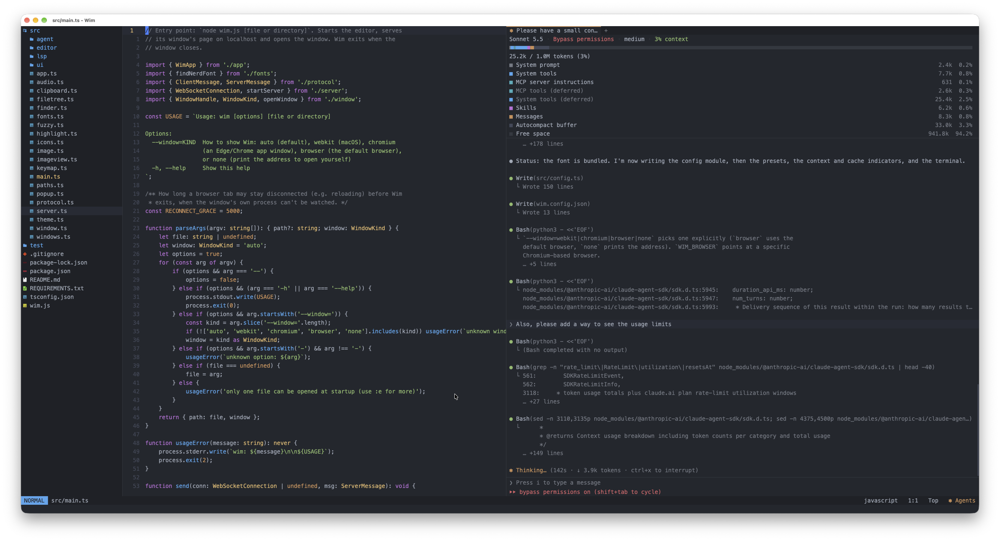
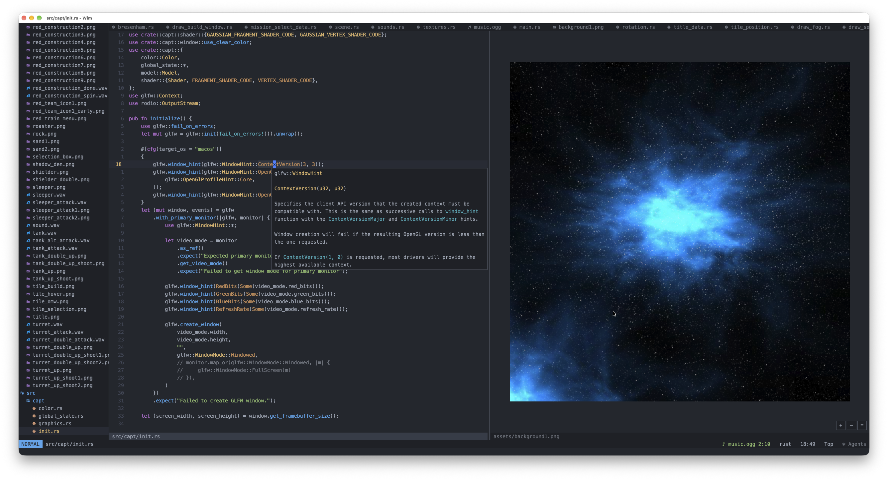
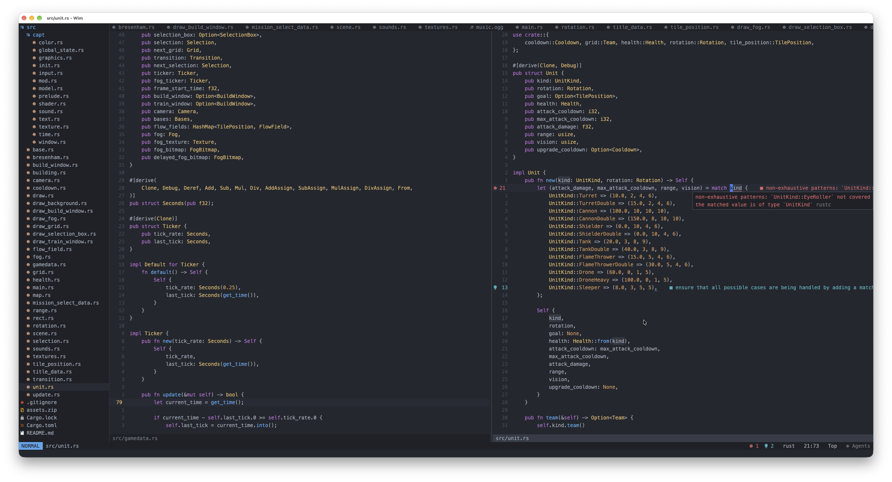
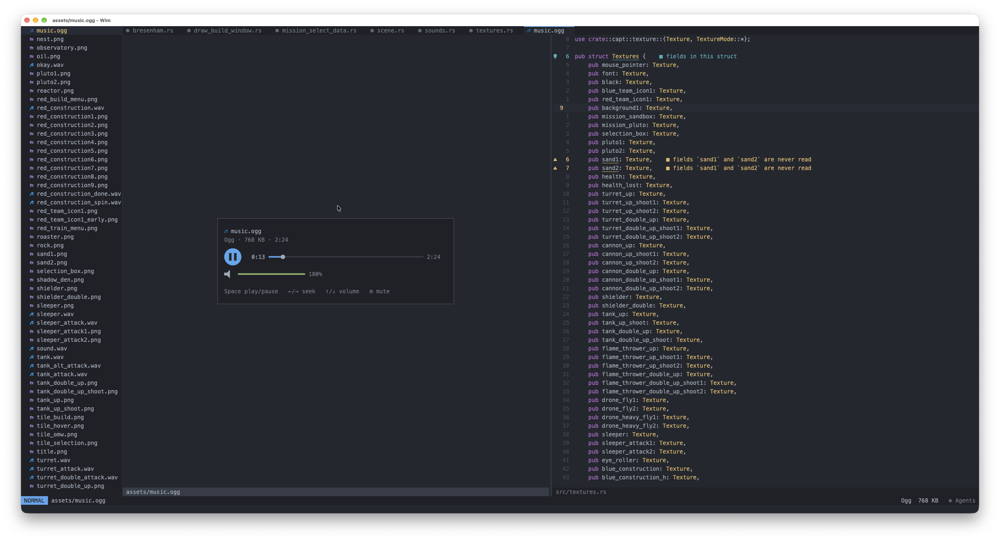

# Wim (Windowed Vim-esque Editor)

A Vim-like, personalized code editor created on a wim. It's a Windowed Vim-esque Editor, basically NeoVim except better. Less bloated, supports standard features like LSP, file tree, telescope, etc. Also supports images and audio/music playback, and runs anywhere.









Despite being Vim-like, Wim runs as a native window and not as a terminal app.

Wim uses Node.js and opens a native window, without any native code of its own.

```sh
npm install            # installs the TypeScript compiler (development only)
node wim.js path/to/file.rs   # works in the file's directory
node wim.js .          # a directory: works there, with no file open (Ctrl+n for the tree)
```

To run it as `wim`, link `wim.js` into a directory on your `PATH`, for example
`ln -s "$PWD/wim.js" /opt/homebrew/bin/wim` (or `npm link`).

Requires Node.js 20 or later. `wim.js` compiles the TypeScript sources into `dist/` on first run,
and again whenever they change. Wim runs until its window closes.

## The window

The editor runs in Node; the window only draws frames and forwards input, over
a WebSocket on localhost that only accepts this session's token.

| Platform | Window |
| --- | --- |
| macOS | A Cocoa window with a WebKit view, created through `osascript` (JavaScript for Automation), which ships with macOS |
| Windows | A Microsoft Edge app window (no tabs or address bar). Edge ships with Windows 10 and 11; Chrome is used if Edge is missing |
| Linux | An app window from Edge, Chrome, Chromium or Brave |

`--window=webkit|chromium|browser|none` picks one explicitly (`browser` uses the
default browser, `none` prints the address). `WIM_BROWSER` points at a specific
Chromium-based browser.

File icons use the FiraMono Nerd Font that comes with Wim in `fonts/` (with its license), so
nothing needs installing. If `fonts/` has no Nerd Font, an installed one is used instead.

## Settings

`wim.config.json` in Wim's own directory holds its settings; a missing file or key means the
default, and a mistake in it is reported at startup and ignored.

```json
{
    "theme": "onedark",
    "claude": {
        "enabled": false,
        "presets": {
            "low": { "model": "claude-haiku-5-5", "effort": "low" },
            "medium": { "model": "claude-sonnet-5-5", "effort": "medium" },
            "high": { "model": "claude-opus-5-5", "effort": "high" }
        },
        "defaultPreset": "medium",
        "cacheMinutes": 60
    },
    "terminal": { "shell": "zsh" }
}
```

| Setting | Meaning |
| --- | --- |
| `theme` | `onedark` (default) or `nord`; `,th` still switches while running |
| `claude.enabled` | Whether Wim connects to Claude Code at all (default `false`: the agents panel and its badge are off) |
| `claude.presets` | The model (an alias such as `haiku`, or an id) and effort (`low`, `medium`, `high`, `xhigh`, `max`) for low, medium and high complexity tasks |
| `claude.defaultPreset` | The preset new sessions start with (default: Claude Code's own settings) |
| `claude.cacheMinutes` | How long the prompt cache lasts after a request, for the cache indicator (default 60) |
| `terminal.shell` | The shell the terminal runs (default `zsh`, or `powershell.exe` on Windows) |

## Layout

| Path | Purpose |
| --- | --- |
| `wim.js` | Entry point |
| `src/editor/` | Editor core, independent of the window and unit tested |
| `src/editor/command.ts` | Parses Normal/Visual key sequences (`"a3d2w`, `ci(`, `gUiw`) into commands |
| `src/editor/motion.ts`, `textobj.ts`, `ops.ts` | Motions, text objects, operators |
| `src/editor/buffers.ts` | Multiple buffers and file I/O |
| `src/editor/ex.ts` | `:` commands |
| `src/editor/search.ts` | Translates Vim regex syntax to JavaScript regular expressions |
| `src/highlight.ts` | Syntax highlighting for Rust, C/C++, JS/TS, Python, Go, Java-likes, shell, Lua, JSON and config files |
| `src/filetree.ts` | The sidebar file tree |
| `src/keymap.ts` | Key mappings translated from `~/.config/nvim/init.lua` |
| `src/icons.ts` | File icons, generated from nvim-web-devicons plus `~/.config/nvim/lua/dev_icons.lua` |
| `src/app.ts` | Window logic: routes input (mappings, focus, mouse) and paints the tree, buffer tabs, text, gutter, cursor, status line and command line as drawing commands |
| `src/window.ts` | Opens the window on each platform |
| `src/server.ts`, `src/protocol.ts` | The local page and WebSocket, and the messages they carry |
| `src/ui/client.ts` | The window's side: draws frames on a canvas and sends input back |
| `src/clipboard.ts` | System clipboard through `pbcopy`/`pbpaste`, PowerShell, or `wl-clipboard`/`xclip`/`xsel` |
| `src/lsp/` | Language server client: `rpc.ts` (JSON-RPC framing), `client.ts` (one server process), `servers.ts` (which servers, where to find them, project roots), `manager.ts` (keeps servers in sync with buffers, diagnostics, edits), `features.ts` (go to, hover, rename, ...), `completion.ts` |
| `src/popup.ts` | The completion menu, hover/diagnostic floats and the picker |
| `src/finder.ts` | Finding files and searching text for the pickers, with ripgrep or without it |
| `src/image.ts`, `src/imageview.ts` | Which files are images, their format and size, and zooming them |
| `src/markdown.ts` | Markdown's rendered view: blocks laid out as rows, with their links, images and diagrams |
| `src/links.ts` | Links between Markdown files: what a link points at, and which file and line that is |
| `src/audio.ts` | Which files are sounds, and the player's state |
| `src/config.ts` | The settings file, `wim.config.json` |
| `src/terminal.ts` | The integrated terminal: a shell process, its output and the prompt |
| `src/agent/` | The agents panel: `backend.ts` (Claude Code through the Claude Agent SDK), `session.ts` (one session: its conversation, prompts and settings), `transcript.ts` (the conversation laid out as rows), `input.ts` (the prompt), `panel.ts` (sessions, keys, mouse and painting) |

Run the tests with `npm test`.

## Supported Vim features

**Modes:** Normal, Insert, Replace (`R`), Visual (`v`), Visual Line (`V`), command line (`:`, `/`, `?`).

**Motions:** `h j k l`, `w W b B e E ge gE`, `0 ^ $ g_ |`, `gg G` (with counts),
`f F t T ; ,`, `%` and `N%`, `{ }`, `H M L`, `+ - _ <CR>`, `n N * #`, marks (`ma`, `'a`, `` `a ``, `''`).
Counts work everywhere (`3w`, `d2w`, `2d3w`).

**Operators:** `d c y > < gu gU g~`, combined with any motion or text object; doubled
forms for whole lines (`dd`, `cc`, `yy`, `>>`, `gUU`).

**Text objects:** `iw aw iW aW`, `i" a" i' a'`, ``i` a` ``, `i( a( ib`, `i{ a{ iB`, `i[ a[`, `i< a<`, `ip ap`.

**Editing:** `x X s S D C Y p P r J gJ ~ u <C-r> . <C-a> <C-x>`, `i a I A o O gI`,
with counts (`3ix<Esc>`, `3.`, `5x`). Yanked text flashes briefly.

**Registers:** unnamed, `"a`–`"z` (uppercase appends), `"0`, `"1`–`"9`, `"-`, black hole `"_`,
and the system clipboard as `"+` / `"*`.

**Insert mode:** auto-indent, extra indent after `{ ( [`, a closing `}` dedents,
`<Tab>` inserts spaces, `<BS>` removes one indent level, `<C-w> <C-u> <C-t> <C-d>`.
Autopairs, as nvim-autopairs is set up in the Neovim config: typing `(`, `[`, `{`, `"` or
`` ` `` adds its closer (not before a letter, digit or quote, and a quote not right after a
word or to close a string), typing a closer that is already there steps over it, and `<BS>`
between an empty pair deletes both. `'` is left alone. `"""` in Python and ```` ``` ```` in
Markdown get closing triples. Confirming a function or method from the completion menu adds
`()` with the cursor inside. `:set noautopairs` turns it off.
macOS word editing: Option+Left/Right move by word, Option+Delete (⌫) deletes the word before
the cursor, Option+fn+Delete (⌦) deletes the word after it. Option+Left/Right also move by
word in Normal mode, and Option+Delete deletes a word on the command line.

**Scrolling:** `<C-d> <C-u> <C-f> <C-b> <C-e> <C-y>`, `zz zt zb`, mouse wheel. Unlike Vim,
`<C-d>` and `<C-u>` move only the cursor (half a page); the view scrolls only as far as the
cursor needs (`scrolloff`).

**Search:** incremental, highlights matches, wraps around. Vim regex syntax: `\<word\>`,
`\(group\)`, `\|`, `\+`, `\{n,m}`, `\v`, `\c`.

**Buffers:** `:e file` opens a file in a new buffer (or switches to it if already open), and
each buffer keeps its own cursor, undo history and marks. `:ls`, `:b N`, `:b name`, `:b#`,
`<C-^>` (alternate buffer), `:bn`, `:bp`, `:bfirst`, `:blast`, `:bd[!] [N]`, `:enew`, `:wa`,
`:wqa`/`:xa`. A tab line across the top shows the open buffers when there is more than one;
click a tab to switch. `:q`, `:wq`, `:x`, `ZZ` and `ZQ` close the current buffer, and quit only
when it is the last one; `:qa` quits everything and refuses while any buffer has unsaved changes.

**File tree:** Ctrl+n shows or hides a sidebar tree of the working directory and focuses it,
set up like the nvim-tree config: 30 columns wide, Nerd Font folder and file icons (from an
installed Nerd Font such as FiraMono Nerd Font), git-ignored files hidden, no root label. It
follows the current file. In the tree: `j`/`k` move, `gg`/`G` jump, `<CR>`/`o` opens a file or
toggles a folder, `l` expands, `h` collapses or goes to the parent, `a` creates a file in the
selected folder (or the selected file's folder; a trailing `/` makes a folder, and missing
folders are made too), `R` re-reads the disk, `q` hides it, `<Esc>` returns to the editor. Ctrl+h / Ctrl+l (or `<C-w>h`, `<C-w>l`, `<C-w>w`)
move focus between the tree and the editor. Clicking works too.

## Language servers

Rust files use [rust-analyzer](https://rust-analyzer.github.io/); TypeScript and JavaScript
files use [typescript-language-server](https://github.com/typescript-language-server/typescript-language-server);
Python files use [pylsp](https://github.com/python-lsp/python-lsp-server), with the Neovim
config's pycodestyle settings.
Wim looks for each in the project's own copy, then Neovim's Mason directory
(`~/.local/share/nvim/mason/bin`), then the `PATH`. For TypeScript the project's copy is in
`node_modules/.bin`. For Python it is the virtual environment's (`.venv` or `venv` in the
project, or an activated `$VIRTUAL_ENV`): its `pylsp`, or else its Python running `-m pylsp`,
so the server sees the project's packages; when a virtual environment exists, a pylsp from
elsewhere is pointed at its Python too. Last, the first `python3` on the `PATH` is tried with
`-m pylsp`. If none start, the message says why each one failed. A server
starts when the first file it handles is opened, rooted at the nearest Cargo workspace or crate
(`Cargo.toml`); `tsconfig.json`, `jsconfig.json`, `package.json` or `.git`; or
`pyproject.toml`, `setup.py`, `setup.cfg`, `requirements.txt`, `Pipfile` or `.git`. Files in
the same project share one server.

- **Diagnostics:** underlined, with the message after the line, a sign in the sign column
  (which also colors the line number) and counts in the status line. They update as you type.
- **Completion** pops up while typing in Insert mode, nvim-cmp style: nothing is preselected,
  `<Tab>`/`<S-Tab>` (or `<C-n>`/`<C-p>`) select and put the item's word in the text,
  `<C-l>` or `<C-Space>` confirm (the first item if none is selected), `<C-e>` closes.
  Confirming also applies the item's extra edits, such as an auto-import. `<C-Space>` with no
  menu asks for completions.
- **Signature help** appears above the line while you type a call's arguments (after `(` or
  `,`), with the current parameter picked out and its documentation; it follows along and
  closes when the call does. It moves below the line when the completion menu is above.
- **Hover** (`K`) shows documentation in a float; press `K` again to move into it and scroll
  (`j`/`k`, `<C-d>`/`<C-u>`, `g`/`G`), `q` or `<Esc>` to leave.
- **Pickers** (references, symbols, code actions, diagnostics) work like Telescope: type to
  filter, `<C-n>`/`<C-p>` or the arrows to move, `<CR>` to choose, `<Esc>` to close. Those
  with locations show a preview of the selected one beside the list when the window is at
  least 120 columns wide.
- **Formatting:** files are formatted by their server when written (conform.nvim's
  `format_on_save` with `lsp_fallback`), then written again. `:LspFormatOnSave off` turns this
  off for the session.
- Other uses of the symbol under the cursor are highlighted once the cursor rests (250 ms).
- Edits to files that aren't open (from a rename, say) go into background buffers, left
  unsaved; `:wa` saves them.
- `:LspInfo` shows the running servers; `:LspRestart` restarts them.

## Images

PNG, JPEG, WebP, GIF and BMP files open as images: shown in the middle of the window,
shrunk to fit if larger, with the format, size and file size in the status line. A small image
that would fit two or more times its size opens enlarged by the most whole times that fit. Images open
from the command line, `:e`, the tree or a picker, and pickers preview them. An image buffer
can't be changed or written (`E21`), so it is safe to `:w` or `:wa` with one open.

To zoom: scroll (or pinch on a trackpad) to zoom around the pointer, or use the `+`, `-` and
`=` buttons in the bottom right corner (`=` fits the window again). On the keyboard, `+` or `=`
zooms in, `-` zooms out and `0` fits the window again. Drag, or press `h`/`j`/`k`/`l` or the
arrow keys, to move it; the middle of the window always stays over the image. Keys and buttons
glide to the new zoom or place; holding a key keeps going. Enlarged two times or more, pixels
are drawn sharp. The status line shows the zoom.

## Markdown

`,m` or `:MarkdownPreview` switches a Markdown file between editing it and reading it rendered:
markup dropped, paragraphs wrapped, code highlighted and tables drawn. `j`/`k`, Ctrl+d/u/f/b,
Space, `gg` and `G` scroll it; `,m` again goes back to the text at the same place.

**Links** between notes work as in Obsidian, with the working directory as the vault:
`[[Note]]`, `[[Note#Heading]]`, `[[Note#^block-id]]`, `[[Note|shown text]]`, `[[#Heading]]`
in the same note, and Markdown links such as `[text](other%20note.md#heading)`. In the text,
`gf` or Enter on a link follows it, as does Cmd+click (Ctrl+click on Windows and Linux); in the
rendered view, click it. A note is looked for beside the current one, then from the vault's top,
then by name anywhere in the vault (the nearest first), so `[[Note]]` finds `notes/Note.md`.
A note that doesn't exist yet opens as a new buffer beside the current one, made when written
(`:w`). Following a link from the rendered view opens the note rendered too, and `<C-o>`
comes back (`<C-i>` goes forward again). Web links (`https:`, `mailto:`) open in the default
browser. Elsewhere `gf` opens the file whose name is under the cursor, as in Vim.

**Images** on a line of their own, `` or `![[pic.png]]`, are shown in the
rendered view, shrunk to fit; `![[pic.png|300]]` or `` sets the width
(`300x200` both). Clicking one opens it. Images within text, and those on the web, are shown as
their names, and their links work.

**Mermaid diagrams** (```` ```mermaid ```` blocks) are drawn in the rendered view in Wim's
colors, by [Mermaid](https://mermaid.js.org/), which the window loads the first time it shows
one. A diagram Mermaid can't read shows its error and its source.

## Split windows

`:sp [file]` (or `<C-w>s`) splits the window in two, one above the other; `:vs [file]` (or
`<C-w>v`) side by side; `:new` and `:vnew` (`<C-w>n`) split with a new, empty buffer. The new
window comes first (above or left) and is active. Windows share the space evenly, and each has
a name bar under it. Each window has its own cursor and scroll position, even on the same
buffer.

Ctrl+h/j/k/l (or `<C-w>h`/`j`/`k`/`l`, or the arrows after `<C-w>`) move between windows; from
the leftmost window Ctrl+h goes to the file tree. `<C-w>w`/`W` go round them all (the tree
first), `<C-w>p` back to the previous one. Clicking a window moves there, and scrolling over
another window scrolls it. `:q` closes a window while there are others (its buffer stays open);
`:close` and `<C-w>c` close one, `<C-w>q` is `:q`, and `:only` or `<C-w>o` keeps only the
active one. Closing a buffer closes the windows showing it.

## Colors

Wim's colors follow Atom's One Dark. `,th` (as in the Neovim config) or `:colorscheme nord`
switches to Nord, as nord.nvim draws it with the config's settings, with lualine's Nord colors
for the mode in the status line; `,th` again or `:colorscheme onedark` switches back. The
choice lasts until Wim exits.

Highlighting works as in Neovim: syntax highlighting sorts code into the kinds tree-sitter
does (keywords, types and builtin types, functions, modules, attributes, constants, numbers,
operators, delimiters, brackets...), and a language server's semantic tokens, when it sends
them (rust-analyzer and typescript-language-server do), refine it: parameters, functions,
methods, namespaces and so on, as nord.nvim colors `@lsp.type.*`. A line that changed uses
syntax highlighting until fresh tokens come. Nord draws comments in italics, as the Neovim
config sets it.

## Sounds

MP3, WAV, FLAC, Ogg, Opus, AAC (`.m4a`, `.aac`) and WebM (`.weba`) files open in a player: the
file's name, format, size and length, a play/pause button, a scrubber with the time, and the
volume. Click or drag the scrubber to seek and the volume bar to set the volume. On the keyboard:
Space, Enter or `p` play and pause; `h`/`l` or ←/→ seek 5 seconds; `0`–`9` go to that tenth of
the way through; `k`/`j` or ↑/↓ change the volume; `m` mutes. A sound keeps playing in other
buffers (the status line shows it) and stops when its buffer is closed; one sound plays at a
time. Like images, sound buffers can't be changed or written. Which formats play depends on the
window's browser engine; if one can't, the player says so.

## Agents

The agents panel is off until `claude.enabled` is `true` in `wim.config.json` (see
[Settings](#settings)); until then Cmd+L, `,cc` and `:Agents` say so, and the badge is not shown.

Cmd+L (Ctrl+Shift+L on Windows and Linux), `,cc` or `:Agents` shows the agents panel on the
right for chatting with Claude Code, and moves to it; Cmd+L from the panel hides it again.
`:Agents message` also sends the message. The `✻ Agents` badge at the end of the status line shows and
hides the panel too when clicked; it turns orange when a session is waiting for an answer, and
spins while Claude works.

Each session is a Claude Code session (through the
[Claude Agent SDK](https://www.npmjs.com/package/@anthropic-ai/claude-agent-sdk), which brings
its own copy of Claude Code), working in Wim's working directory with Claude Code's own
settings, tools, `CLAUDE.md` and sign-in. Its process starts with the first message. Several
can be open at once, as tabs along the top of the panel; sessions are saved by Claude Code as
usual, so any of them (from Wim or the terminal) can be resumed with its history.

The conversation shows messages, replies (Markdown, with highlighted code), thinking, and
tool calls with a line or two of their results (a diff for edits); replies stream in, with a
spinner, the time and the tokens while Claude works. Under the tabs are two rows. The first has
the session's preset, model, permission mode and effort, each clickable. The second has its
context use (a meter and a percentage), the plan limit closest to running out (5 hours or the
week), the prompt cache and the cost. The cache shows the time left (`cache 3m`; yellow in its
last minute) and turns red as `cache cold` once it has run out, when the next message has to
send the whole conversation again; it is counted from the last reply, so it is an estimate
(`claude.cacheMinutes` sets its length). The meters go from green to yellow at 50% and red at 80%.

**Presets** are the model and effort for a low, medium or high complexity task, set in
`wim.config.json` (see [Settings](#settings)). `L`, `M` and `H` switch the session to one
(even while it works: it applies to the next request), `P` or a click on the preset picks one,
and `u` (or a click on the plan limit) shows the plan's usage limits, as `/usage` does: the
5-hour and weekly windows with when they reset. Plan limits only exist for Claude subscriptions.

The panel has two modes, like Vim. In the prompt at the bottom, Enter sends (a `\` before it,
or Option/Alt with it, makes a new line instead), Up/Down go through earlier messages, Esc
goes to Normal mode, and the usual text field keys work (Option+Left/Right, Option+Delete,
Ctrl+a/e/w/u). Ctrl+c is Esc there too, and Ctrl+h goes to the editor, as in Normal mode. In Normal mode:

| Keys | Action |
| --- | --- |
| `i` `a` Enter | Type in the prompt |
| `S` | Clear the prompt and type in it |
| `j` `k`, Ctrl+d/u/e/y/f/b, `gg` `G`, the wheel | Scroll the conversation (it follows new replies unless scrolled up) |
| Tab `]` `[` `gt` `gT` `1`–`9` | Next, previous or Nth session |
| `n` / `s` / `x` | New session / pick a session, open or saved, to switch to or resume / close a session (stopping its process; twice if Claude is working) |
| `m` / `p` / `e` | Pick the model / permission mode / effort |
| `L` `M` `H` / `P` | Use the low / medium / high preset / pick a preset |
| Shift+Tab | Cycle the permission mode: default, accept edits, plan, auto (in the prompt too) |
| `c` | Context use by kind, as `/context` shows it |
| `u` | Plan usage limits (5-hour, weekly) |
| `y` | Copy the last reply |
| `?` | All of these keys |
| `q` / Esc / Ctrl+h | Hide the panel / back to the editor / back to the editor (Ctrl+l from the rightmost window returns) |
| Ctrl+x | Interrupt Claude, in either mode (Ctrl+c is Esc, as in the editor) |

When Claude wants to use a tool that needs permission, the prompt shows what it will do (the
command, a diff, the plan) and takes the keys: `1`–`4` or the arrows and Enter pick Yes, Yes
and don't ask again (with Claude Code's suggested rule), No, or No and say what to do instead;
Esc denies. A prompt Claude Code marks as risky starts on No and can't be approved with a
single key. Questions from Claude (AskUserQuestion) are answered the same way, ticking several
with Space where it asks for more than one, or typing another answer. Slash commands
(`/compact`, `/clear`, ...) are sent to Claude Code.

When Claude edits a file that is open in a buffer, the buffer is reloaded (as one undoable
change), and after a command buffers whose files changed are reloaded too. A buffer with
unsaved changes is kept, with a warning if Claude edited its file.

## Finding files and text

`,a` lists the files under the working directory and `,fw` searches their text as you type,
each in a picker with a preview, like Telescope's `find_files` and `live_grep`. Both use
[ripgrep](https://github.com/BurntSushi/ripgrep) (`rg`) when it is installed, with the
Neovim config's arguments, so they skip what `.gitignore` ignores and hidden files; `,fw`
takes a regular expression and is case-insensitive unless it has capitals. Without ripgrep,
Wim lists files with git (or by walking the directory) and searches them itself. Paths under
`node_modules` are left out, as in the Neovim config. `<CR>` opens the file, at the match
for `,fw`.

## Key mappings

These come from `~/.config/nvim/init.lua`. The leader is `,`, and a key that could start a
longer mapping waits 300 ms (`timeoutlen`) before being typed normally. As in Neovim,
Normal-mode mappings don't apply in the middle of a command, so `f,` still finds a comma.

| Keys | Mode | Action |
| --- | --- | --- |
| Ctrl+h/j/k/l | Normal | Move to the window to the left / below / above / right (the file tree is leftmost) |
| Ctrl+h/j/k/l | Insert | Move the cursor left/down/up/right |
| Tab / Shift+Tab | Normal | Next / previous buffer |
| Ctrl+n | Normal | Toggle the file tree |
| `,cc` (or Cmd+L) | Normal | Show the agents panel (see [Agents](#agents)) |
| `,tt` (or Cmd+J) | Normal | Show the terminal (see [Terminal](#terminal)) |
| `,th` | Normal | Switch between Wim's colors (One Dark) and Nord |
| Ctrl+y | Normal | Forward in the jump list (`<C-i>`, which is Tab in a terminal) |
| `,w` `,b` `,e` `,ge` | Normal, Visual, after an operator | Like `w`, `b`, `e`, `ge` for subwords (nvim-spider): camelCase humps, snake_case parts and digit runs; single punctuation is skipped |
| `,;` `,o` `,'` | Normal | `:w` |
| `,:` | Normal | `:wqa` |
| `,v` / `,V` | Normal | `:q` / `:q!` |
| `,x` / `,X` / `,K` | Normal | Close this buffer / all buffers / all other buffers |
| `,p` / `,P` | Normal, Visual | Paste the last yank (`"0p` / `"0P`) |
| `,d` | Normal, Visual | `dd` |
| `,m` | Normal | Switch a Markdown file between editing it and reading it rendered (see [Markdown](#markdown)) |
| `gf` / Enter | Normal | Follow the Markdown link under the cursor (`gf` elsewhere: open the file named under the cursor; Enter elsewhere: as usual) |
| Option+j / Option+k (`∆` `˚`) | Normal, Visual | `}` / `{` |
| `[f` / `]f` | Normal, Visual | Jump to the outermost enclosing `{` / `}` |
| Option+Shift+j / k | Normal | Start Visual Line mode |
| Option+Shift+j / k | Visual | Move the selected lines down / up |
| Option+a/r/s/t (`å` `®` `ß` `†`) | Normal | Jump to global mark A/R/S/T and centre (`'Azz`) |
| Option+Shift+a/r/s/t | Normal | Set global mark A/R/S/T |
| Option+c / Option+d (`ç` `∂`) | Normal | Insert the next typed character before / after the cursor |
| Esc | Normal | Also clears search highlighting |
| `gd` / `gD` / `gi` / `gt` | Normal | Go to definition / declaration / implementation / type definition (a picker if there are several) |
| `gr` | Normal | References, in a picker |
| `K` / `zK` | Normal | Hover documentation |
| `,ra` | Normal | Rename the symbol under the cursor |
| `,ca` | Normal, Visual | Code actions for the cursor or selection |
| `,f` | Normal, Visual | Format the buffer |
| `,S` / `,fs` | Normal | Document symbols / workspace symbols (searched as you type) |
| `]d` / `[d` | Normal | Next / previous diagnostic, shown in a float |
| `]1`–`]4` / `[1`–`[4` | Normal | Next / previous error, warning, info, hint |
| `,a` | Normal | Find files under the working directory (Telescope `find_files`) |
| `,fw` | Normal | Search the working directory's files as you type (Telescope `live_grep`) |
| `,q` | Normal | All diagnostics, in a picker |
| `,z` or `,1` / `,2` / `,3` / `,4` | Normal | Errors / warnings / info / hints, in a picker |

On Windows and Linux, Alt works like Option in these mappings (Alt+j is `}`, Alt+Shift+j moves
lines, and so on).

Mappings for plugins Wim doesn't have (gitsigns, Rust auto-import, inlay hints) are left
out, as is the `=` re-indent step of the line-moving
mappings.

**Ex commands:** `:w [file]`, `:q[!]`, `:wq`, `:x`, `ZZ`, `ZQ`, `:e[!] [file]` (Tab completes paths),
`:[range]s/pat/rep/[gie]` (`\1` and `&` in the replacement), `:d`, `:y`, `:m`, `:t`, `:>`, `:<`,
`:j`, `:sort[!] [iu]`, `:noh`, `:reg`, `:pwd`, `:cd`, `:{N}`, `:undo`, `:redo`.
Ranges: `%`, `.`, `$`, `N`, `'<,'>`, `'a`, `+N`/`-N` offsets. Buffers: `:%bd` closes all,
`:bonly` closes all but the current one.

**Jump list:** `<C-o>` goes back to where you jumped from and `<C-i>` (or `<C-y>`) forward
again, across files: jumps are `G`, `gg`, searches, `%`, `{`/`}`, `H`/`M`/`L`, marks, `:N`,
going to a definition or other location, picker choices and opening another file.

**Marks:** `a`–`z` are per buffer; `A`–`Z` are global and jump to their file, reopening it if
it was closed.

**Motions also include** `[{` `]}` `[(` `])` (enclosing unmatched bracket).

**Options (`:set`):** `number`, `relativenumber` (both on by default: relative numbers, with
the absolute number on the cursor line), `ignorecase`, `smartcase`, `hlsearch`,
`incsearch`, `expandtab`, `autoindent`, `autopairs`, `tabstop`, `shiftwidth`, `scrolloff`,
`clipboard=unnamed`. Each supports the `no`, `!` and `?` forms.

**Desktop additions:** click to place the cursor, drag to select, Cmd+C / Cmd+X copy or cut the
selection, Cmd+V pastes, Cmd+S saves, Cmd+L shows the agents panel, Cmd+J the terminal, Cmd+= / Cmd+- / Cmd+0 zoom, Cmd+W / Cmd+Q close. On Windows
and Linux these are Ctrl+Shift+C, Ctrl+Shift+V and so on, since Ctrl alone belongs to Vim. Closing
the macOS window with unsaved changes shows a warning first; closing again discards the changes. In
an Edge or Chrome window, the browser asks before closing with unsaved changes instead.

## Terminal

Cmd+J (Ctrl+Shift+J on Windows and Linux), `,tt` or `:Terminal` shows a terminal under the
editor and moves to it; the same again hides it. It runs zsh (PowerShell on Windows; set
`terminal.shell` to change it) as a login shell in Wim's working directory, and the shell is kept
between commands, so `cd` and variables stay. Type a command and press Enter; Up/Down go through
earlier commands and the usual text field keys work. The wheel and PageUp/PageDown scroll the
output, `clear` empties it, Cmd+V pastes (as one line), Esc (Ctrl+c) stops a running command, or
else clears what is typed, or else goes back to the editor. Ctrl+k goes up to the editor, Ctrl+h to
the tree and Ctrl+l to the agents panel, as with windows.

Wim has no native code, so this is not a full terminal: output is shown as plain text (colors and
cursor movement are dropped), and programs that take over the screen (vim, less, top) or ask for
input while they run don't work. Stopping a command restarts the shell in the same directory, so
variables set before are lost. The shell is a login shell but not an interactive one, so what is
in `~/.zshrc` (aliases, prompt) does not apply. The Windows PowerShell setup is untested.

## Not supported yet

Macros (`q`); Visual Block mode; line wrapping; undo of only part of an Insert session;
resizing split windows
